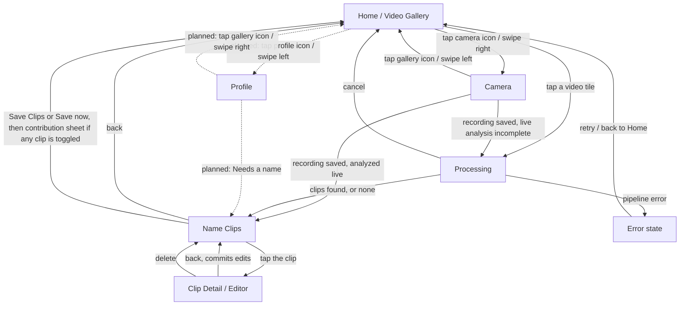

# Turnip — UI/UX Flow (v1 MVP)

*Rev 21 · 2026-10-27 · Clip List is retired: an analysis lands on Name Clips
(§3a), which now carries the triage Clip List did. Tapping the clip opens the
editor, its trash button discards it, the header's "+" adds one, and the
header's menu marks the original for deletion after saving. Name Clips' card
has a fixed size, so a swipe, a name added or the keyboard can't resize it, and
the clip beside the current one waits paused on its first frame, so a swipe
slides in the video it is about to play.*

*Rev 20 · 2026-10-26 · Name Clips (§3a) is built: Clip List's main button is
"Next: name clips" with "Save without names" under it, and Name Clips names
each clip, carries its contribute toggle, saves, and then opens the
contribution confirmation sheet when any saved clip was toggled
([`CONTRIBUTION_DESIGN.md`](CONTRIBUTION_DESIGN.md) §3.3). The clip library the
save also writes, the names in each exported file, and the Profile's "Needs a
name" entry stay planned.*

*Rev 19 · 2026-10-26 · Follow mode's keyframes hold the zoom and the turn as
well as the position (§4, "Zoom and turn by keyframe"). Pinch and two-finger
rotate set the keyframe at the playhead the way a drag does, and a long press
on a diamond can give every keyframe its zoom and turn. Auto follow zooms with
the athlete, keeping the still crop's padding and never tighter than a crop
768 source pixels on its longer side, and writes one turn for the whole clip.
Decision 8 records the change.*

*Rev 18 · 2026-10-23 · The user chooses whose tricks become clips: the one
person the pose model is surest of, or everyone it finds, each with clips of
their own. The choice is a control on the camera (§1b) and a picker above
"Analyze clips" on Processing (§2), one remembered setting behind both.
Following everyone, clips of different people can overlap on Clip List (§3),
each tile's crop showing whose trick it is.*

*Rev 17 · 2026-10-22 · Reconciliation (issue #152): the Decisions log's bulk
keep/discard entry gains its reversal audit trail — the "Select All" /
"Deselect All" toolbar button shipped on main, then was removed again with
the keep/discard → trash-toggle change (decision 6). The closed issue links
(#11, #17, #21) are re-tensed to past tense and kept as provenance.*

*Rev 16 · 2026-10-19 · The Clip Editor gets two framing
modes, Still and Follow, switched by a segmented control in the header's
title slot (§4). Still mode is today's editor, with the switch in its
header. In Follow mode the crop
moves with the athlete: Auto follow writes a few keyframes, a drag on the
video at any moment adds or moves one, and a follow lane scaled to the trim
window shows them and scrubs between them. Keyframes hold position only;
zoom and level stay the whole clip's. Settings' Follow the athlete becomes
the mode a detected clip starts in (§1a). Decision 8 records why.*

*Rev 14 · 2026-10-15 · Planned, not built: the root pager gains a third
page, Profile ([`PROFILE_DESIGN.md`](PROFILE_DESIGN.md)), reached by
swiping left from Home or by a third icon on the floating bar. Clip List's
"Save Clips" becomes "Next: name clips", which opens a new Name Clips
screen (§3a) where clips are named and then saved, with a quieter "Save
without names" under it; Clip List's tiles and the Clip Editor are
unchanged. Saving also writes the clips to an on-device clip library. The
Profile's own screens are specified in its design doc, not here.*

*Rev 13 · 2026-10-09 · A clip added by hand has no pose analysis, so its
crop button is "Reset crop" alone — disabled on the whole frame, enabled
once a pinch or drag has moved the framing — instead of an Auto crop that
could never change anything.*

*Rev 12 · 2026-10-08 · The editor's surround outside the crop marker is
frosted glass — the same material as Processing's and Clip List's bottom
bars — rather than a flat dim: the video blurs everywhere export cuts away
and stays sharp only inside the marker, with the controls on top of the
glass. The expansion flight shows the crop alone; the frosted frame around it
appears once the flight lands.*

*(Rev 1 established the five-screen flow and made Home a Photos video gallery. Rev 2 resolves the three open questions into decisions. Rev 3 adds the Settings screen this doc previously scoped out. Rev 4 adds the expansion transition, with the *how* in its own companion doc. Rev 5 adds "A gesture and its button play one animation." Rev 6 replaces the Clip Editor's "Reset crop area" with Auto crop and Auto rotate. Rev 7 adds "An automatic change moves, it never cuts." Rev 8 stops trimming from re-cropping. Rev 9 tightens Auto crop's padding and keeps its crop inside the video. Rev 10 applies that to detection's rects. Rev 11 levels by the take's own roll track, with the picture's horizon as the fallback, and makes Auto crop / Auto rotate toggles with a reset. Rev 12 frosts the editor's surround. Rev 13 gives a hand-added clip Reset crop in place of Auto crop. Rev 14 plans the Profile page and naming in the clip flow. Rev 15 adds Follow the athlete to Settings. Rev 16 adds Still and Follow framing modes to the Clip Editor. Rev 17 reconciles the Decisions log and closed issue links. Rev 18 adds the choice between one person and everyone. Rev 19 plans zoom and turn by keyframe in Follow mode. Rev 20 builds Name Clips and opens the contribution sheet after its save. Rev 21 retires Clip List into Name Clips.)*

Companion to [`DESIGN.md`](DESIGN.md), which specifies the auto-edit *pipeline*
(pose detection → motion signal → peak detection → crop rect → export), and to
[`EXPANSION_TRANSITIONS.md`](EXPANSION_TRANSITIONS.md), which specifies *how*
the tap-to-expand/collapse animation two of this doc's navigations use actually
works — this doc only specifies *that* it happens. This doc specifies the
*screens* the v1 app needs to carry a user from "I have a
recording" to "clips are in my Photos library," and is scoped to v1
(auto-clip + auto-crop, iOS-only, on-device). It does not cover v2 (community
labeling, following/feed) — those get their own flow notes once the v1 screens
exist and v2 work starts. The first of them is the Profile tab, whose screens
live in [`PROFILE_DESIGN.md`](PROFILE_DESIGN.md) §5–§8; this doc carries only
what it changes in the v1 flow — the root pager's third page, the Name Clips
screen an analysis lands on (§3a), and saving into the clip library — the
parts not built yet marked *Planned*. OTA model updates were scoped here as v2 and have
since been built ahead of that; see "Built ahead of this doc" below.

## Why this doc exists

`DESIGN.md`'s "Preview UI" bullet describes behavior ("thumbnail per detected
clip, tap-preview, drag-adjust start/end, keep/discard toggles") but not
screens. In practice that behavior needs at least two distinct screens — a
list/triage view and a per-clip editor — plus states DESIGN.md doesn't
mention at all: a loading state while the pipeline runs, an empty state when
no tricks are detected, and a confirmation state after export. Issue
[#11](https://github.com/hoiekim/turnip-ios/issues/11) bundled all
of this into one "Preview UI" issue; this doc was written to pin the flow down
before that issue was split and shipped.

## A gesture and its button play one animation

Whenever a gesture and a control lead to the same place, they play the same
transition: the same motion, in the same direction, over the same geometry.
The control plays the animation that the gesture would have driven, from
start to finish. It never cuts, cross-fades or pushes when the gesture
slides, grows or shrinks.

The motion is how the user learns where a screen lives. A swipe teaches
"Camera is to the left of Home." A tile that grows into Processing teaches
"this screen *is* that video, enlarged." If the button for the same move
then cuts straight to the destination, the button teaches nothing and
contradicts what the gesture taught. The user ends up with two mental models
of one layout, and the button reads as a glitch.

How it's built: each transition has a single entry point that both the
gesture and the control call. The control never reaches into the state some
other way. A gesture can control the motion's progress directly (it follows
the finger and can be cancelled), and a control plays that same motion all
the way through on its own. Only who drives the progress differs. The
destination and the motion are the same.

Where it applies today:

| Transition | Gesture | Control | Shared motion |
|---|---|---|---|
| Home ↔ Camera (Root navigation) | Horizontal page swipe | Floating bar's camera / gallery icons; Camera's cancel chevron | The pager's horizontal slide (`RootTabView.slide(to:)`) |
| Tile ↔ Processing (§1, §2) | Swipe down anywhere on the page | Back chevron | The tile's expansion card shrinking back into the tile ([`EXPANSION_TRANSITIONS.md`](EXPANSION_TRANSITIONS.md)) |
| Name Clips card ↔ Clip Editor (§3a, §4) | Swipe down above the crop marker | Back chevron | Same, with the card showing the editor's own player |
| *Planned:* Home ↔ Profile (Root navigation) | Horizontal page swipe | Floating bar's gallery / profile icons | The pager's horizontal slide (`RootTabView.slide(to:)`) |
| Name Clips, one clip ↔ the next (§3a) | Horizontal swipe | "Next" / "Skip" | The page slide between clips (`NameClipsView.go(to:)`) |
| *Planned:* Profile clip tile ↔ Clip view ([`PROFILE_DESIGN.md`](PROFILE_DESIGN.md) §5.2) | Swipe down | Back chevron | The tile's expansion card, showing the clip's own player |

Not every state change has a gesture counterpart that it owes an animation.
A recording that finishes on Camera switches to Home *instantly*, because the
same update opens the expansion cover over Home, and a page still sliding
underneath would hand the cover's flight a moving source frame. The user
sees the expansion, not the page change. That switch is the result of an
operation finishing, not a navigation the user chose, so there is no gesture
whose motion it would contradict.

New screens follow the same rule: if a screen can be reached both ways,
build the gesture's transition first and route the button through it.

## An automatic change moves, it never cuts

When the app changes something on the user's behalf that the user could
have changed by hand — a fit, a reset, a re-framing, a reorder — the screen
moves continuously from where it is to the result. It never cuts. The
change travels along the same geometry the hand gesture would have driven:
a fit that zooms, turns and shifts the video plays as a zoom, a turn and a
shift, over an easing curve, not as a new picture replacing the old one.

A cut tells the user *that* something changed and nothing else. The motion
tells them *what* changed and *by how much*: a horizon that visibly turns
five degrees to level teaches what Auto rotate measured, and a crop that
visibly pulls in around the athlete teaches what Auto crop found. It also
keeps the result reversible in the user's head — they saw where the video
came from, so they know what pulling it back by hand would mean. A cut
reads as the app having replaced their work; a motion reads as the app
having adjusted it.

How it's built: the automatic change writes the same state the gesture
writes, inside an animated transaction. Nothing else differs — no
separate animated path, no snapshot cross-fade. A result that arrives
asynchronously (a detection that had to sample frames) animates when it
lands, from whatever the state is at that moment.

Where it applies today:

| Change | By hand | Automatic | Shared motion |
|---|---|---|---|
| Clip Editor crop fit (§4) | Pinch / rotate / drag the video under the marker | "Auto crop" | The video's scale, rotation and offset about the crop center, eased over 0.4 s |
| Clip Editor leveling (§4) | Two-finger rotate | "Auto rotate" | The video's rotation about the crop center, eased over 0.4 s |
| Clip Editor follow fit (§4) | Drag, pinch or turn the video at a few moments in Follow mode | "Auto follow", "Apply zoom and turn to all keyframes", removing a keyframe, and an untouched Auto follow re-tracking a trimmed window | The video's position, zoom and turn eased over 0.4 s to the curves at the playhead, then the curves play |
| Clip Editor framing mode (§4) | Pinch, rotate and drag | The "Still \| Follow" switch | The video's scale, rotation and offset moving from one mode's framing to the other's, eased over 0.4 s |

This is the companion of the principle above: that one says a button plays
the gesture's *transition*; this one says an automatic change plays the
gesture's *adjustment*. Both come from the same idea — the motion is how
the user learns what the screen did.

## Screen inventory

The whole app forces dark appearance (`.preferredColorScheme(.dark)` in
`ContentView`) — black backgrounds throughout, no light-mode variant. This is
a v1 product decision (see "Decisions" below), not a per-screen choice.

### 0. Launch screen

The system launch screen (`UILaunchScreen` in `Turnip/Resources/Info.plist`:
the `LaunchLogo` image on the `LaunchBackground` color) covers app start.
There is no SwiftUI splash: `ContentView` mounts the root tab view directly.

### Root navigation

`Turnip/App/RootTabView.swift` hosts the app's two pages — Camera and Home
— in a swipeable `TabView` (`.page` style, native page dots hidden), with a
custom floating pill bar overlaid at the bottom rather than the system tab
bar: camera icon on the left, gallery-grid icon on the right, gallery
selected by default. Tapping an icon or swiping the page (right reveals
Camera, since it's the page before Home) both drive the same selection
state *and the same motion*: a tap (or Camera's cancel chevron) pages
through `slide(to:)`, which changes the selection inside an animated
transaction. A page-style `TabView` only scrolls to a selection that changes
that way, and cuts to it otherwise. So Camera slides in from the left on a
tap exactly as it does under the finger (see "A gesture and its button play
one animation" above). It also owns the one `VideoLibraryViewModel` shared by both pages —
a finished recording needs to hand its asset into the same
`select(_:)` a tapped gallery tile calls, then switch back to the gallery
tab so the pick lands the way tapping a tile always has.

The pill is a true overlay, not a safe-area inset — the gallery grid (and
Camera's record button/lens row) scroll or sit underneath it rather than
stopping short, so it reads as floating over the content instead of a docked
bar. It renders in Liquid Glass on iOS 26+ (`.ultraThinMaterial` below that),
with a sliding selection pill behind whichever icon is active — visible on
both pages, so the pill has something to slide between on a tap or a page
swipe alike. Camera keeps its own cancel chevron too; the bar there is an
additional way back, not a replacement. It's hidden only once Home opens
Processing/ClipList/ClipEditor — a tap flies the tile into the full-screen
destination rather than pushing it (see "Tapping a tile" below and
[`EXPANSION_TRANSITIONS.md`](EXPANSION_TRANSITIONS.md)) — each of which owns
the full screen and its own back chevron, reappearing once back at the grid.

*Planned — a third page* ([`PROFILE_DESIGN.md`](PROFILE_DESIGN.md) §5): the
pager becomes Camera | Home | Profile, with Profile the page after Home, so a
left swipe on Home reveals it the way a right swipe reveals Camera. The pill
gains a third icon after the gallery icon, and the selection pill slides
across all three. A tap on the profile icon pages through the same
`slide(to:)` the swipe drives, so the button plays the swipe's motion. Home
stays the default page. Screens pushed from Profile — an achievement, a
trick's gallery, a highlight, a clip — hide the pill and own the full screen
like Processing/ClipList/ClipEditor do, and `PageSwipeLock` switches the pager
off while one is open, for the same reason it does over Home: the pager would
otherwise take every horizontal drag first.

### 1. Home / Video Gallery

Entry point *is* the picker — every video in the device's Photos library, not
a button that opens a picker sheet. No account, no settings required for v1
— nothing in `DESIGN.md`'s v1 scope needs either. An ordinary full-screen
scrollable grid (`Turnip/Home/HomeView.swift`, `VideoGalleryView`), newest
videos first, top-to-bottom, three columns. The "Turnip" wordmark (one image of
the app mark and the title, 36 pt tall) heads the grid as
scroll content, leading-aligned, so it scrolls away with the tiles rather
than floating over them, and the tiles run under the status bar. The filter
and settings controls sit at the trailing end of the same band — filter,
then gear. On iOS 26 they are the nav bar's own trailing items, two
separate glass circles (`HomeNavigationBar`); before iOS 26 the bar is hidden
outright and they float in a corner overlay row level with the wordmark.
Beyond those two items Home's nav bar is visually empty,
transparent, and takes no space: the content ignores the band the bar would
reserve, so at rest the wordmark sits directly under the status bar with no
empty gap above it. The bar is there so iOS 26 draws its scroll-edge glass
over the status bar and that band as tiles pass beneath, the same blur Clip
List gets from its titled bar: its principal item is an invisible title text,
because nothing else draws a real blur (a hidden bar or a `safeAreaBar`
standing in for one gets no glass at all, and a non-text bar item only a dim
gradient). The glass stays hidden until the content actually scrolls, since
the header rests inside the bar's band — no custom landing state, no
swipe-to-reveal. Tapping a tile flies it open, Photos-style, into Processing
for that video (straight to Name Clips instead, for a camera take live
inference already covered — §1b) — the tile grows smoothly to fill the
screen rather than the screen pushing in from the side, landing on the
tile's own thumbnail immediately rather than waiting on the tap's resolve
(which can take a moment for an iCloud video) before showing any motion. The
resolve's own progress, if it takes a moment, shows on that growing card
instead of a separate loading screen. The reverse — Processing's back
control, or a swipe down anywhere on it — shrinks the same way back into the
tile (Name Clips' back slides sideways instead, §3a), landing on whichever tile is actually current if
Processing's own swipe-to-browse-neighbors (§2) moved on from the one first
tapped. See [`EXPANSION_TRANSITIONS.md`](EXPANSION_TRANSITIONS.md) for the
mechanics.

**Permission model** (shipped, in `Turnip/Home/`): because Home *is* the
gallery, it enumerates video `PHAsset`s itself rather than delegating to an
out-of-process picker, so it needs real Photos access. As built:
- Read/write authorization (`NSPhotoLibraryUsageDescription`) requested
  on first launch, via `PHPhotoLibrary.requestAuthorization(for:)`.
- **Limited** access shows the granted videos plus a banner opening
  `presentLimitedLibraryPicker`, rather than looking empty.
- **Denied** or restricted access shows an empty state pointing at
  Settings, since there is no picker fallback once Home is the gallery.
- Thumbnails come from a `PHCachingImageManager` prefetching around the
  visible rows, over 60-asset pages, so a library with hundreds of
  videos scrolls without stalling on first load.

**Filter** (shipped, `Turnip/Home/GalleryFilter.swift`): a `Menu` button just
before the settings gear at the header band's trailing end, mirroring the
Photos app's own filter — All Items,
Favorites, or a specific user album (nested submenu). The filter changes the
underlying `PHFetchOptions`/`PHAssetCollection` fetch itself, not a
post-filter of the loaded grid, so paging and Processing's swipe-to-browse
stay correct against the filtered set. "Edited" is not offered: PhotoKit has
no fetch-level predicate for it, only a per-asset resource scan that would
make every filter change scale with library size instead of staying
fetch-level. Dimmed and disabled without library access (denied or not yet
determined) rather than left tappable with no effect. An active (non-All
Items) filter switches the button's glyph to its filled variant and carries
the same state as the control's `accessibilityValue`, so it's never only a
visual signal. A filter matching no videos shows its own empty state ("No
matches", the filter's name, a Clear Filter button) instead of the library's
default empty state, so it never reads as "your library is empty."

### 1a. Settings

- Reached by tapping the gear at the trailing end of Home's header band, after the filter
  (§1). On iOS 26 it is a real `ToolbarItem` in `HomeNavigationBar`'s bar, inside the bar's own
  hit-testing hierarchy. That bar is visually transparent (`.toolbarBackground(.hidden, ...)`,
  for the iOS 26 scroll-edge glass described under "1. Home / Video Gallery" above) but still
  hit-tests its own frame ahead of SwiftUI content drawn under it, so a control drawn as content
  inside that band is unreachable on a real device even though every static check
  (touch-target size, accessibility identifier, screenshot coverage) passes, since none of them
  exercises real hit-testing against a system nav bar. Before iOS 26 the bar is hidden outright
  and the gear is a `ScrimIconButton` (`HomeSettingsButton`) in a corner overlay row, level with
  the wordmark. Presented as a sheet, not pushed onto the flow's `NavigationStack`: it has nothing
  to hand back to Home and isn't part of "pick a video, get clips."
- Five preferences on this screen, `UserDefaults`-backed (`Turnip/Settings/TurnipSettingsStore.swift`),
  each taking effect at its own integration point rather than needing a restart:
  - **Analysis mode** (segmented Real-time / Offline) — whether the camera scores pose live while
    recording (§1b below) or always defers to Processing (§2). Real-time is the default.
  - **Save to an album**, with a name field shown once it's on — whether Name Clips' save
    (§3a) adds each saved clip to a named Photos album (created on first use) instead of landing
    with no album, the default. Scoped to the curated clip exports only: a camera recording's raw
    take, saved to Photos the moment recording stops (§1b), never goes in the album.
  - **Analysis granularity** (stepper, 1-30, default 10) — frames sampled per second of footage,
    replacing the fixed rate `docs/DESIGN.md`'s "Performance targets" describes; both the file
    path and the live path (§1b) sample at this rate.
  - **Follow the athlete** (toggle, off by default) — the framing mode a detected clip starts
    in (§4): off starts it in Still, one framing held for the whole clip; on starts it in
    Follow with Auto follow applied, its crop moving with the athlete through the trick
    (`docs/DESIGN.md` pipeline step 6, "Follow crop in the editor"). Read once when the Clip
    List opens, so the tiles, their looping previews and Save Clips agree on it. The editor
    keeps either mode, so a clip adjusted in Follow mode still follows. The original tile and a
    "+" clip start in Still, and a clip whose path never moves plays as a still crop in either
    mode.
- A sixth preference lives in the same store but not on this screen: **person mode** (One
  person / Everyone, default One person), whose tricks a take or an analysis is cut into clips
  for. It is chosen where it takes effect, on the camera before recording (§1b) and on
  Processing before "Analyze clips" (§2), and remembered between them.
- Under the preferences, when the build points at a farm (`TURNIP_FARM_ENDPOINT`), a
  **Contribution** section: Sign in with Apple while signed out; "Signed in with Apple", Sign
  Out and Delete Account once signed in, deletion confirming with the farm's disclosure first
  ([`CONTRIBUTION_DESIGN.md`](CONTRIBUTION_DESIGN.md) §5.4). It is an account, not a
  preference, and nothing outside contribution reads it.
- Further settings beyond these six are out of scope for this doc's current revision.

### 1b. Camera

- One of the root tab view's two pages (see "Root navigation" above), not a
  modal — reached by tapping the floating bar's camera icon or swiping the
  page right from Home. Minimal v1 scope: full-screen back-camera preview, a
  cancel chevron (slides back to the gallery tab, the same slide a left
  swipe plays), and one record button
  (tap to start, tap again to stop) — no flip camera, flash, or zoom
  (`Turnip/Camera/`).
- Needs `NSCameraUsageDescription` and `NSMicrophoneUsageDescription`
  (Info.plist); denied/restricted access shows a message pointing at
  Settings, matching Home's own denied state.
- While recording, pose inference runs on the live camera frames and the
  scored skeleton is drawn over the preview (`docs/LIVE_POSE.md`): the one
  person followed, or everyone found.
- A person control leads the top-right group: one figure while the take will
  be cut into clips for one person (the person the pose model is surest of
  in each frame), two figures while it will be cut for everyone, each person
  with clips of their own (`docs/MULTI_PERSON.md`). A tap switches between
  them. The choice is remembered, and it is the same setting Processing's
  picker shows (§2). It is read when Record is tapped, so the control is
  dimmed and disabled while recording, like the format and flip controls.
- While recording, the phone's roll is written into the take as a timed
  metadata track (`RollTrack`, `RollTrackRecorder`): gravity from the motion
  sensors, sampled 30 times a second and expressed as the horizon's tilt in
  the recorded picture. It needs no permission prompt and leaves the device
  only inside the user's own video file. The editor's Auto rotate (§4)
  levels an in-app take by it, instead of guessing from the picture.
- A finished recording is saved to the Photos library (via the same
  `ClipPhotosSaver` Name Clips' save uses) rather than kept as a private file —
  that turns it into an ordinary `PHAsset`, so it re-enters the flow the
  way a tapped gallery tile does: `RootTabView` calls
  `VideoLibraryViewModel.select(_:detectedClips:)` on the newly-created
  asset and switches to the gallery tab. When live inference covered the
  whole take, its clips travel with the selection — with the scored
  frames they were cut from, which the editor's crop fits need — and the
  take lands on Name Clips directly (§3a) with no analysis step; otherwise it lands on
  Processing's idle state as if the user had tapped a tile, carrying the
  frames live inference did score, so "Analyze clips" analyzes only the
  stretches it missed and its progress starts where live inference left off.

### 2. Processing

- The pipeline does not auto-start, but the picked video does: it fills the
  screen (fit to the screen, no native playback chrome) and starts playing
  automatically on arrival, Photos-app style — no tap needed to see it. A thin
  scrub bar (play/pause, seek, mute) draws over the bottom, then a segmented
  picker, "One person | Everyone", for whose tricks the analysis cuts clips
  for (the same remembered setting as the camera's person control, §1b), with
  a large, full-width "Analyze clips" button below it and a quieter "Clip
  manually" text button under that, in the same bar — black background, no title,
  no caption text, back chevron to Home. The user watches the autoplaying
  video, pausing/scrubbing it via the scrub bar if they want, and starts
  analysis when ready — or skips it: "Clip manually" goes straight to Name
  Clips (§3a) with no detected clips, for cutting clips by hand with its "+". The back chevron, and a swipe down anywhere on the
  page, video included (see the swipe bullet below), both shrink the
  screen back into Home's tile rather than popping or dismissing outright —
  [`EXPANSION_TRANSITIONS.md`](EXPANSION_TRANSITIONS.md) covers the mechanics
  this screen's own swipe-to-dismiss gesture drives.
- Once started, the video stays on screen (paused) rather than being replaced
  by a separate page: a progress panel — spinner or determinate bar, plus
  "Analyzing frame 400 of 1,200" — overlays the bottom of the still-visible video,
  dimmed behind it. This is not instant for a multi-minute input video, so
  needs real progress feedback, not just a spinner.
- On success the pipeline navigates to Name Clips — even a run that finds zero trick
  windows (e.g. the user picked a video with no motion peaks) still navigates there
  rather than stopping on this screen; Name Clips itself says "No tricks found"
  (§3a).
- One exit besides success: the **Error state** — pipeline throws (unreadable video,
  pose model failure). Message + retry, or back to Home.
- A swipe here navigates the grid rather than reaching Camera: right browses
  to the previous video in Home's grid order, left to the next, replacing the
  screen in place (not stacking a new one, so the back chevron still returns
  to Home in one step) — disabled while an analysis is running. The whole
  page — video and bottom controls — follows the finger while the back
  chevron stays put over it, and the neighbor's page slides in alongside it showing that video's poster
  frame, the way the Camera page arrives over Home; once it has landed, its
  player takes over from the poster in place. A drag that falls short springs
  back, a quick flick commits even when short, and at either end of the grid
  the page gives only a little, since there is no video that way. Where the
  drag starts makes no difference — the leading edge, the top band, the
  bottom strip, the video itself — with one carve-out: the scrub bar's own
  track (`VideoScrubBar`), which claims a horizontal drag for
  scrubbing. A drag's direction is fixed by its first movement: one that
  starts mostly downward drives the expansion transition's own interactive
  dismiss instead (shrinking live with the finger, landing back on Home's
  tile), from anywhere on the page, video included, and is likewise disabled
  while an analysis is running.
  This screen draws no navigation bar and its own back chevron, because the
  stack's bar would sit over the page without moving with it or passing a
  drag to it. And the Camera/Home pager (§1) is switched off while this
  screen (or Name Clips/Editor) is open over Home, because its swipe would
  otherwise take every horizontal drag before this screen saw it.

### 3. Clip List *(retired 2026-10-27)*

Clip List was the grid an analysis used to land on, ahead of Name Clips. Its
triage moved into Name Clips (§3a), one clip at a time, and the grid is gone:

| Clip List | Now, on Name Clips (§3a) |
|---|---|
| A tile per detected clip, looping its window | The page's card, looping its window at a fixed size |
| Tap a tile → the editor | Tap the card → the editor, by the same expansion flight |
| A derived tile's trash | The card's trash button |
| The "+" tile | The header's "+" |
| The original tile's trash ("Will be deleted") | The header's "…" menu: "Delete original after saving", and a notice above the save |
| The read-only range timeline on each tile | The same timeline over the card's bottom edge |
| The saved-to-Photos checkmark after a partial failure | The same checkmark on the card |
| "No tricks found" notice over a near-empty grid | Name Clips' empty state |
| "Save Clips" / "Save without names" | "Save Clips" on the last clip, "Save now" before it |

The original video no longer has a tile of its own: nothing on the screen
edits it, and marking it for deletion is the one thing it offered.

### 3a. Name Clips *([`PROFILE_DESIGN.md`](PROFILE_DESIGN.md) §4)*

- Where an analysis lands (§2), and where a camera take live inference fully
  covered lands directly (§1b): pushed onto the cover's stack with no grid in
  between. The back chevron pops to Home — a sideways slide, not a shrink back
  into the video's tile, since this screen shows clips cut from the video, not
  the video (`EXPANSION_TRANSITIONS.md`, Rev 9) — and nothing is saved.
  *Planned:* the same screen opens from the Profile's "Needs a name" for clips
  saved without names.
- One detected clip at a time, on a card looping its window with the framing
  export uses, cropped and rotated to the clip's adjustment. The card is a
  square of a fixed size worked out from the screen alone: the width less its
  insets, giving up height only where the naming controls wouldn't fit below
  it, never below 220 pt. A swipe, a name added, a "did you mean" line or the
  keyboard can't resize or move it; when the controls need more room, the page
  scrolls. The card's poster stands in only until the loop's first frame. The
  clip beside the current one builds its loop paused on its first frame, so a
  swipe slides in the video it is about to play, in the tone it plays in,
  rather than a poster that cuts to it.
- The card carries the triage:
  - tapping it flies it open, Photos-style, into the Clip Detail / Editor (§4)
    — the same tap-to-expand transition Home uses to reach Processing
    ([`EXPANSION_TRANSITIONS.md`](EXPANSION_TRANSITIONS.md)) — and back into
    the card, which waits hidden at its own frame while the clip is open;
  - a trash button in its top-trailing corner discards the clip outright, with
    no restore, and the next clip slides into its place (the previous one when
    it was the last); the editor's Delete does the same;
  - a thin, read-only timeline over its bottom edge spans the whole video with
    the clip's window highlighted. It isn't draggable — trimming happens in the
    editor. VoiceOver reads it as the card's value ("Clip from 3.0s to 4.5s of
    6.0s");
  - a green checkmark in its top-leading corner on a clip already in Photos,
    which is only ever on screen after a save that partially failed. It takes
    no tap: the corner still opens the editor.
- The header: the back chevron, the counter ("2 of 4"), a "+" that adds a new
  full-frame clip over the first seconds of the video and slides to it for the
  user to trim in the editor, and a "…" menu with "Delete original after
  saving". With that on, a red line above the save says "The original video
  will be deleted after saving." On iOS 26 the "+" and the menu are two glass
  circles, split by a fixed spacer as on Home.
- A video analyzed following everyone (§2) has a clip per person's trick, in
  start order, so two clips can cover the same moment; each card's crop frames
  its own person, and nothing else marks whose clip it is.
- With no clip — a run that found none, every clip discarded, or a video that
  arrived by "Clip manually" — the screen says "No tricks found" (the first) or
  "No clips yet" (the others) over "Add a clip, then trim it to the trick in
  the editor", with "Add Clip" as the screen's button. The menu is hidden.
- Under the card:
  - the trick-name field ("What trick is this? e.g. cork"); each committed
    name becomes a removable chip, and a combo takes several;
  - suggestion chips — names already used on this video first, then the
    trick vocabulary as the user types, led by the vocabulary name a typed
    near miss is closest to; once the trick model ships, the names it is
    confident in arrive already filled in. Chips wrap into rows rather than
    scroll sideways, since the paging owns horizontal drags;
  - "Did you mean **gainer**?" under the chips when the newest typed name is
    a near miss of a vocabulary name; a tap puts the vocabulary's spelling in
    its place;
  - who's in it — me (default) or someone else. The first clip's choice
    carries to the rest of the video's clips; any clip can change it;
  - when the build points at a farm, a "Contribute this clip" toggle, off by
    default and disabled until the clip has a name, and for a clip added by
    hand, which has no pose to send
    ([`CONTRIBUTION_DESIGN.md`](CONTRIBUTION_DESIGN.md) §3.3).
- Horizontal paging: a swipe left goes to the next clip, a swipe right to the
  previous one, and the "Next" button plays the same slide (see "A gesture and
  its button play one animation"). As on Processing (§2), the paging owns every
  horizontal drag — there is no edge-swipe back, only the chevron — and at the
  first or last clip the page gives only a little. A drag that starts vertical
  scrolls the page instead and never pages. The button reads "Skip" while the
  clip has no name; naming is never required.
- On the last clip the button reads "Save Clips": it exports and saves every
  clip not yet in Photos under a full-screen spinner, deletes the original
  from Photos if it was marked — only once every clip has confirmed it saved,
  so a failure can't cost the user's only copy of a trick — and pops to Home.
  A clip that fails leaves the screen up with an alert naming the failure, and
  the retry saves only what is still missing; a clip edited after a partial
  failure loses its checkmark and is written again, and the pre-edit copy stays
  in Photos, since the app keeps no identifier for an asset it wrote.
  *Planned:* the save then writes the clip library, with each clip's names
  also in its exported file; until that lands, names reach nothing but a
  contribution. Under the button, from the first clip on, a quieter "Save now"
  (`PrimaryActionBar`'s secondary) saves at once and leaves the clips not
  reached yet unnamed, so a long take never costs a row of Skips. *(Judgment
  call.)* It steps aside while the name field has focus, to leave the keyboard
  room. A name typed and left without pressing return still counts: "Next", a
  swipe, the chevron, opening the editor and a save all commit it as typed. If
  any saved clip was toggled to contribute, the contribution confirmation sheet
  opens once the save has finished, before Home; "Not Now" sends nothing.
- When the name field has focus, the page scrolls the field and the
  suggestions above the keyboard, and keeps them there as names are added;
  the card scrolls up with the page rather than shrinking.
- *Planned:* opened from "Needs a name", the clips are already in Photos: the
  last button reads "Done" and writes names to the clip library only, and
  there is no "Save now".

### 4. Clip Detail / Editor

- Reached by tapping the clip's card on Name Clips (§3a) — the card's single
  detail entry point, not a separate pencil icon. Full-screen, one clip at a
  time:
  - Video player showing the trimmed clip looping under the crop marker: one
    rectangle of the export's aspect ratio, the same size at the same place on screen
    for every clip in the same framing mode, centered in the band between the header row and
    the controls (Follow mode's lane makes its marker shorter; see "Two framing modes"
    below).
    The video is laid out so the clip's crop rect fills the marker exactly — a
    different clip, or an adjustment to the framing, moves and scales the video,
    never the marker — and the rest of the frame shows around it through frosted
    glass (the same material as Processing's and Name Clips' bottom bars), edge to
    edge, running under the header and the controls rather than clipped to a box:
    only the picture inside the marker is sharp, and the controls sit on the glass.
    The marker is what export cuts to. No default AVKit playback chrome; the only
    controls this screen shows are the custom play/pause and mute buttons and the
    scrub bar below.
  - The crop area is directly editable: pinch to zoom, rotate with two fingers, and
    drag with one finger to reposition the video underneath the fixed marker
    rectangle — the video zooms/rotates/moves, the marker never does, and whatever
    the adjustment pushes outside the frame's own rect stays visible instead of
    being cut off. Two buttons fit the video under the marker for the user:
    "Auto crop" frames every body part the pose model located in the clip
    range inside the marker, at whatever rotation the video currently has —
    so after a trim, or after a turn, one tap refits the crop to the range
    (issue #9), and it is the only thing that does; a manual pinch or drag is
    discarded. The fit is the pipeline's own framing for the range (the body
    parts' box plus a tenth of it on each side — joints stop at the eyes,
    wrists and ankles, and a tenth reaches the head, hands and feet), with
    one more rule: the crop shows video in every part of it. The crop's
    footprint on the video — a turned rectangle, once the video is rotated —
    is slid inside the frame, and when the body parts' box can't fit the
    frame at the crop's ratio (an athlete crossing most of a landscape
    frame), the crop zooms in to the frame's edge and parts of the athlete
    leave it: no black beyond the frame's edge ever shows in the crop, which
    outranks holding every body part. Detection's own crop rects (DESIGN.md
    step 6) follow the same rule, so a clip opens the way Auto crop would
    frame it. "Auto rotate" levels the clip by the camera's roll: a take
    recorded in the app carries its roll as a track in the file (§1b), read
    off the phone's gravity sensor while it recorded, and the button averages
    the samples across the clip range (the roll can drift during a clip) and
    turns the video so that roll is cancelled. A video with no roll track —
    every imported one — falls back to reading the horizon's tilt off frames
    sampled across the range with Vision's horizon detector, which is a guess:
    right on a sky-over-ground scene, confidently wrong in a gym, where it
    locks onto the ceiling trusses and floor lines. A clip with nothing to
    level by says so in a notice and keeps its rotation. The two are
    independent one-shot fits: Auto rotate changes only the rotation, so a
    limb the turn carries out of the marker is Auto crop's to bring back.
    Both move the video to their result rather than cutting to it ("An
    automatic change moves, it never cuts", above).
    Each button is a toggle. Once its fit is on screen it reads "Reset crop"
    or "Reset rotate" and returns to the original video — Reset crop to the
    whole source frame centered in the marker, the way a clip added by hand
    opens (not the detected crop), Reset rotate to no rotation — not to
    whatever the fingers had set just before the Auto tap. It moves there the same
    way the fit moved, and then offers the fit again. The two are independent:
    resetting one leaves the other's result and button alone. Any manual
    pinch, turn or drag returns both buttons to "Auto", since the fits are
    no longer what's on screen; a trim does not, since a trim is not a
    re-crop. The state is per editor session: a clip reopened starts at
    "Auto".
    A clip of a video that skipped analysis ("Clip manually", §2) carries no
    pose analysis, so there is nothing for Auto crop to fit (a "+" clip on an
    analyzed video keeps the Auto crop toggle, since the video's pose frames
    cover it); an Auto crop whose tap could never
    change anything would read as broken. Its crop button is "Reset crop"
    alone: disabled while the framing is the whole source video, enabled once
    a pinch or drag has moved it (a turn alone doesn't count — that is Reset
    rotate's), and returning to the whole frame the same way. Auto rotate is
    unchanged there, since leveling reads the video, not the pose.
  - Scrub bar spanning the whole source video (not a zoomed range around the
    window) with drag handles on start/end — adjusts the trick window from
    issue #8's output. A handle drag is a trim, not a re-crop: the framing
    — the crop rect the clip opened with plus the adjustment above — never
    moves while the handles do. Re-deriving the crop from the window on
    every drag made the crop grow with the range (every keypoint the wider
    window held pulled the box out, and the video visibly shrank under the
    fixed marker); the framing is what the user last set, and "Auto crop"
    is the one tap that refits it to the trimmed range.
    The window is drawn as a frame around its span: a band in the accent
    color, open in the middle so the track shows through, with a capped
    handle at each end whose glyph points the way it widens. The caps sit
    just outside the range, so a window at the video's full length keeps
    both on the track, and a white playhead pill taller than the frame rides
    over it. All of it is drawn, not an image, so it tints, stretches and
    stays sharp at any scale.
    Full-video handles are naturally imprecise on a long clip, so dragging
    farther vertically from the track slows the handle down (common
    photo/video trim gesture): near the track it tracks the touch 1:1; drag
    away and the same finger movement moves it a smaller fraction of the way,
    for fine control. Moving back to the track snaps to full speed again.
  - A Delete button at the top-right corner discards the clip — the same
    removal the card's own trash button performs (§3a). Unlike the back
    chevron below, Delete fades the screen out in place rather than flying
    back to the card, since the card it would land on no longer holds this
    clip; Name Clips shows the next clip in its place.
  - Back to Name Clips commits the edits and shrinks the screen back into its
    card — the reverse of the tap that opened it, no separate "save" step
    needed since edits are held in view state until back-navigation. A swipe
    down in the band above the crop marker — the top row and the status-bar
    band over it — does the same; the crop pinch/rotate/drag gesture keeps
    sole ownership of the band the marker sits in, and below the marker the
    buttons, the scrub bar and their margins never dismiss, so a drag that
    slips off a control goes nowhere. The screen draws that top row (back
    chevron, title, Delete) as its own content rather than a navigation bar,
    the same way Processing does, so no bar sits over the swipe band — laid
    out in the band a bar would occupy, with the chevron and title at the same
    positions as Name Clips', so the two headers line up through the
    cross-fade (`ScreenHeaderBand`; every bar-less screen's corner controls
    share the same placement). The title's slot holds the Still | Follow switch
    instead (below).
  - **Two framing modes, Still and Follow** (Rev 16). A clip's crop
    either holds one framing for the whole clip (Still: everything above) or
    moves with the athlete (Follow). The UI presents them as two modes, not as
    an effect switched on and off:
    - **The switch.** A segmented control, "Still | Follow", takes the title's
      slot in the top row; the chevron and Delete stay where they are. Naming
      both sides is what makes it read as a choice between two modes. It costs
      two things, both accepted: the control claims a touch that starts on it,
      so a swipe down from there doesn't dismiss (one that starts anywhere else
      in the band still does); and through the expansion cross-fade it fades in
      at the title's slot rather than lining up with Name Clips' counter. The
      screen keeps "Edit clip" as its VoiceOver header. A clip opens in the mode
      it was last committed in. A detected clip that hasn't been opened yet
      starts in the mode Settings' Follow the athlete gives it (§1a); a "+" clip
      starts in Still. Rejected: a mode row above the crop buttons, which would
      shorten every clip's marker, Still mode's included.
    - **What a follow crop is.** A few keyframes, each a moment of the source
      (in seconds, not frame numbers) and the whole crop at that moment, as a
      still crop holds it for the clip: where the video sits under the marker,
      its zoom and its turn (Rev 19; see "Zoom and turn by keyframe" below).
      Between keyframes the crop moves
      on one smooth curve through all of them. It eases out of the first
      keyframe and into the last, and passes through the ones between without
      stopping. Easing each stretch between two keyframes separately would stop
      the crop at every keyframe while the athlete keeps moving; with two
      keyframes the two are the same ease-in-out. The curve never swings past a
      keyframe (`DESIGN.md` step 6). Before the first keyframe and after the
      last, the crop holds still.
    - **Layout.** The crop button becomes "Auto follow" / "Reset follow", next
      to an unchanged Auto rotate. A follow lane appears between the buttons and
      the trim timeline, which still spans the whole video and works as above.
      The lane takes about 44 pt from the stage, so Follow mode's marker is that
      much shorter (about 7% on a 6.9" iPhone), and switching modes animates the
      marker and the video to their new size. The marker is the same size at
      the same place for every clip in the same mode, and the expansion flight
      lands on whichever marker the editor reports.
    - **The follow lane.** It spans the trim window, not the video, so a
      4-second clip from a 3-minute take still gets the lane's whole width. A
      drag anywhere on it scrubs, with the trim timeline's vertical
      drag-to-slow precision, and pauses playback. Each keyframe is a diamond:
      hollow when Auto follow wrote it, filled yellow once the user set or
      moved it. That is the split Photos' Cinematic editor draws between
      automatic and manual focus points, and it shows what tapping Auto follow
      again would replace. Tapping a diamond jumps to it. A button at
      the lane's trailing end adds a keyframe at the playhead, or removes the one
      under it. A long press on a diamond jumps to it and offers a choice:
      remove it, as the button would there, or "Apply zoom and turn to all
      keyframes" (below). Removing a keyframe Auto follow wrote and the user
      changed puts back its position, zoom and turn, hollow again; removing one
      the user added deletes it. A keyframe a
      trim left outside the window shows as a marker at that end of the lane
      and still shapes the curve at the boundary, so widening the trim again
      finds it where it was.
    - **Gestures.** A one-finger drag, a pinch and a two-finger rotate set the
      crop at the playhead's moment: within 0.1 s of a keyframe they change
      that keyframe, anywhere else they add one that starts from where the
      curves already are, so nothing jumps. One two-finger gesture can move,
      zoom and turn the same keyframe at once, and the keyframe is written
      when the fingers lift. Touch-down pauses playback, and the clip stays
      paused on release, showing where it landed, until play is tapped.
    - **Auto follow.** Frames the athlete through the window at one turn for
      the whole clip, the turn the crop has at the playhead: the pipeline's
      follow path for the window (`DESIGN.md` step 6), reduced to a few
      keyframes, each with a zoom of its own (Rev 19, "Zoom and turn by
      keyframe" below). Like Auto crop, it keeps the turn, replaces the zoom
      and the positions, and discards keyframes the user set. The video moves to the
      path at the playhead over the same 0.4 s ease and then follows it.
      Switching a detected clip to Follow when it has no follow crop yet runs
      Auto follow at once: Follow means following the athlete, and waiting for
      a second tap would show a still crop under a Follow label. The button then
      reads "Reset follow", and the toggle rules are Auto crop's: any manual
      pinch, rotate, drag or keyframe change returns it and Auto rotate to
      offering their fits; a trim does not.
    - **Reset follow.** Returns to the whole source frame centered in the
      marker with no keyframes, so the crop holds still, and stays in Follow
      mode; the button then offers Auto follow again. From there a manual
      follow is a few drags at a few moments. A clip with no pose analysis has
      Reset follow alone, disabled while the framing is the whole frame with no
      keyframes and enabled once a pinch, a drag or a keyframe has moved it (a
      turn alone doesn't count), as Rev 13's Reset crop is; Follow mode is
      entirely manual there.
    - **Nothing to follow.** When the crop Auto follow finds neither moves
      nor zooms, because the athlete stays put or a portrait take leaves a 9:16
      crop no room, it frames the athlete with one keyframe, as Auto crop
      would (no tighter than Auto follow's zoom allows), and says "Nothing to
      follow" in a notice where "No horizon
      found" appears. Follow stays usable by hand: pinch in, then drag at a few
      moments.
    - **Switching back and forth.** Each mode keeps its own framing for the
      editor session, so Still → Follow → Still lands on the same still
      framing, and the switch moves the video from one framing to the other
      over the 0.4 s ease. Back (the chevron or the swipe) commits the active
      mode, and the clip keeps the other mode's framing too, so a later switch
      finds it.
    - **Trim.** A trim never moves a keyframe the user set or moved: a trim is
      not a re-crop (Rev 8). One deliberate exception: a follow crop that is
      still entirely Auto follow's, every diamond hollow, re-tracks the new
      window when the handle is released, positions and zoom, at the same
      turn, moving there the way Auto follow does. Its zoom follows each
      moment's own need, so a wider window doesn't widen every moment. Rev 15's grid refit also
      resized the crop, and resizing on a trim is what Rev 8 removed: it made
      the video shrink under the marker as the window grew. Still mode is
      unchanged: its framing never follows a trim.
    - **Playback and export.** The editor plays the follow crop as it loops,
      pauses and scrubs, and the expansion flight's card shows it too, since
      the card is the editor's own player. Save Clips, the tile's loop and its
      poster draw the same curve (`DESIGN.md` step 6), so what the editor shows
      is what export writes.
    - **VoiceOver.** The switch is a standard segmented control. In Follow mode
      the crop area's zooms, turns and moves set the keyframe at the playhead,
      as the gestures do, Reset follow stands in for Reset crop, and the crop
      area adds Previous keyframe, Next keyframe, Add keyframe, Remove keyframe
      and Apply zoom and turn to all keyframes to its actions. The
      lane is adjustable: swiping up or down scrubs a tenth of a second, the trim
      handles' step.
    - **Zoom and turn by keyframe** (Rev 19). A keyframe holds the whole crop
      for its moment, as a still crop does: where the video sits under the
      marker, its zoom and its turn.
      - **The curve.** Position, zoom and turn each move on their own smooth
        curve through the keyframes, easing at the ends and passing through
        the keyframes between without stopping. Zoom moves in proportion, so
        going from 1× to 2× takes as long as going from 2× to 4×.
      - **Gestures** set the keyframe at the playhead, as above. The rule that a
        drag sets nothing when a pinch or rotate reported during it is gone,
        since all three now write the same keyframe.
      - **Apply to every keyframe.** A long press on a diamond also offers
        "Apply zoom and turn to all keyframes": every keyframe takes that
        keyframe's zoom and turn and keeps its own position, moving there over
        the 0.4 s ease. It is the one way to make the whole clip tighter, wider
        or more level at once. It counts as the user's change, so the keyframes
        it changes fill in. The crop area offers the same action to VoiceOver,
        taking the zoom and turn at the playhead.
      - **Auto rotate and Reset rotate** in Follow mode give every keyframe the
        clip's leveling turn, or none, replacing turns set by hand the way Auto
        crop replaces a pinch. Positions and zoom stay, and Auto follow's
        keyframes stay hollow.
      - **Diamonds.** A diamond fills once its position, zoom or turn has
        changed. Removing a keyframe Auto follow wrote and the user changed puts
        back all three.
      - **Manual zoom.** A pinch keeps the editor's own zoom range.
      - **Auto follow** writes positions and zoom from the pose, and one turn
        for the whole clip: the turn the crop has at the playhead. The zoom
        keeps the still crop's padding, a tenth of the body's box on each side,
        and follows the room the athlete needs over a moment rather than each
        limb: it widens before a reach would leave the crop, ignores small
        changes, and closes in more slowly than it opens. So it changes as the
        athlete comes toward the camera or moves away, not with every tuck and
        extension, which is the breathing that kept the zoom clip-wide until
        now. It never zooms tighter than a crop whose longer side is 768
        source pixels, or the frame's own longer side when that is shorter:
        export enlarges a tighter crop to the clip's output size, and the
        picture goes soft. It never zooms wider than the frame. Where a crop
        whose zoom and position both change would show beyond the frame between
        two keyframes, it adds a keyframe. The 768 pixel floor bounds only what
        Auto follow chooses. On 1080p takes the floor still decides many clips:
        when the athlete is far, Auto follow frames a region 768 pixels tall
        and holds that zoom, a little looser than the old clip-wide zoom and
        less enlarged (`DESIGN.md` step 6, "Zoom tuning"). The floor was 1,024
        pixels at first, which held almost every 1080p clip at one looser zoom.
      - **Trim.** A follow crop that is still all Auto follow's re-tracks a
        trimmed window's positions and zoom, at the same turn (above).

## Out of scope for this doc

- Accessibility acceptance criteria per screen — those live in
  [`ACCESSIBILITY.md`](ACCESSIBILITY.md) (issue #22) and are checked on each screen's PR.
- The contribution confirmation sheet and the farm account in Settings —
  [`CONTRIBUTION_DESIGN.md`](CONTRIBUTION_DESIGN.md) §3.3 and §5.4. This doc
  carries only where the sheet opens (§3a).
- The Profile tab's own screens — Needs a name, achievements, the gallery by
  trick, highlights, the Clip view — live in
  [`PROFILE_DESIGN.md`](PROFILE_DESIGN.md) §5–§8; this doc carries only the
  changes to the v1 flow, the ones not built yet marked *Planned*.
- Further Settings options beyond the five §1a covers — aspect ratio, buffer
  duration, and whatever else a future issue asks for stay out of scope until
  one does; the per-clip crop/trim adjustment in Clip Detail's drag handles
  already covers per-clip framing without a setting.
- Visual design (colors, typography, exact layout) — this doc fixes screens
  and transitions, not pixels.

## Built ahead of this doc

One feature this doc scoped as v2 is on `main` already, so a contributor
should start from that code rather than design it again:

- **OTA model updates** — `Turnip/ModelUpdates/`: a manifest client, a version
  store with atomic replace, and a service the app runs on launch and
  foreground, which no-ops when no endpoint is configured — the case today.
  No screen this doc specifies surfaces it, and the doc does not yet say where
  one would go.

A Share Sheet action lived briefly on the Export Confirmation screen this doc
used to specify as §5, retired 2026-09-22 (see decision 6 below). It went with
that screen rather than moving to Clip List, since saving now happens inline
without an intermediate confirmation row to attach a Share action to.

## Decisions (formerly open questions)

Resolved 2026-09-04.

1. **Crop rect editing → Manual override added.** Reopened: the auto-crop stopped
   the trick's landing early often enough (and missed the frame often enough on
   some angles) that users need to fix the crop by hand. Clip Detail now supports
   pinch/rotate/drag directly on the crop area, on top of the algorithm's own
   framing, with "Reset crop area" to undo it. The trim handles still re-derive
   the base crop rect from the window; the manual adjustment composes with that
   rather than replacing it. *Superseded in part, recorded 2026-10-07 (Rev 8):
   the handles no longer re-derive the crop — a trim is not a re-crop, and
   "Auto crop" (Rev 6) is the one tap that refits the framing to the range.*
2. **Bulk keep/discard → Not in v1.** Every clip defaults to "kept"; a user
   discards by tapping individual cards. At ~10 clips per session that's a
   few taps. Add "discard all" only if feedback asks for it. *Reversal
   recorded 2026-10-22 (Rev 17, issue #152): a "Select All" / "Deselect All"
   toolbar button did ship on main, then was removed again 2026-09-22 with
   the keep/discard → trash-toggle change (decision 6) — the decision stands
   as recorded.*
3. **Cancel during processing → Yes.** Processing (#17) shipped a cancel
   action that returns to Home. It's nearly free with structured concurrency
   (cooperative `Task.isCancelled` checks in the frame-sampler loop,
   implemented under #21), and users will background or leave the screen anyway — a clean
   cancel beats a stuck screen. The flow diagram's `Processing → Home` edge
   covers this path.
4. **Preview framing → Superseded by direct crop editing.** Recorded 2026-09-14
   (issue #88): the editor's player showed the cropped 9:16 framing by default
   with a "Show full frame" toggle for context while trimming. Once the crop area
   became directly editable (decision 1, above), the full frame with the crop
   marker overlaid had to be the only view — the toggle and the cropped-only view
   are both gone, replaced by "Reset crop area."
5. **In-app camera + dark-only theme → Added.** Recorded 2026-09-19: v1 no
   longer requires every video to already be in the Photos library before
   Turnip can see it — Home's swipe-up affordance starts a minimal in-app
   camera (§1b), and a recording is saved to Photos and handed to the
   existing `PHAsset` pipeline unchanged. Home also gained the
   collapsed/expanded two-state layout (§1) and the app forces dark
   appearance everywhere, dropping light-mode support. *Superseded in part:
   the swipe-up affordance and the two-state layout are gone. Camera is the
   root pager's other page (§1b, "Root navigation") and Home is a plain
   grid (§1). The dark-only theme stands.*
6. **Export Confirmation retired; Clip List saves inline → Changed.** Recorded
   2026-09-22: the separate Export Confirmation screen (formerly §5) is gone.
   Clip List's "Save Clips" action now exports and saves every non-trashed derived
   clip directly, with a full-screen spinner while it runs — no per-clip
   progress rows, no summary screen, no Share action. Clip List also gained a
   tile for the original source video (always first), and the per-card
   keep/discard toggle became a trash toggle that applies to any tile,
   including the original: trashing the original marks it for deletion from
   Photos, which Save Clips carries out once every derived clip has confirmed it
   saved. The "Select All" / "Deselect All" toolbar action is gone along with
   the keep/discard concept it bulk-toggled. *Clip List itself was retired
   2026-10-27 (decision 9); its inline save is now Name Clips'.*
7. **Camera takes skip Processing → Added.** Recorded 2026-09-23: the camera
   scores pose on its live frames while recording and draws the skeleton on
   the preview; when that covered the whole take, the same trick detection
   Processing runs is applied to the live results and the take lands on Clip
   List straight from Stop. A take live inference could not cover end to end
   (model still loading, device throttling, samples shed) still lands on
   Processing's idle state, so the fallback is never worse than before.
   Tapped gallery tiles are unchanged.
8. **Follow crop in the editor → A second framing mode, edited by keyframes.**
   Recorded 2026-10-19 (Rev 16): the editor has to show and keep the
   follow crop Rev 15 added, offer it both automatically and by hand, let an
   automatic follow be adjusted with the same controls a manual one is built
   with, and present Still and Follow as two modes, without changing the
   framing controls or the marker for someone who never follows. A follow crop is a few keyframes, written by
   Auto follow and by the user's drags alike, so adjusting an automatic follow
   and building a manual one are the same act; Final Cut Pro for iPad's Auto
   Crop works the same way. The pipeline's one-keyframe-per-sample path is
   reduced before it is shown: editors that expose dense generated keyframes
   (Premiere's Auto Reframe, Resolve's Smart Reframe) are known for
   corrections that take longer than starting over. The keyframes sit on one
   curve rather than an ease per stretch, which stops the crop at every
   keyframe (After Effects' Easy Ease and Final Cut's Smooth draw the same
   complaint). Keyframes hold position only; zoom and level stay the whole
   clip's. Four calls, each made against an alternative that would have
   changed Still mode's marker or cost an extra step: the switch takes the header's
   title slot rather than a new row, which would shorten every clip's marker;
   Follow mode's marker is shorter by the lane, rather than one size reserved
   for both modes, which would shorten Still's too; switching a detected clip
   to Follow runs Auto follow at once rather than waiting for a tap; and an
   Auto follow nobody has touched re-tracks a trimmed window, positions only,
   while a touched one stays put. *Revised, recorded 2026-10-26 (Rev 19):
   keyframes hold zoom and turn as well as position.
   Zoom was kept clip-wide so the clip wouldn't breathe with the athlete's
   limbs; Auto
   follow's zoom now follows a smoothed need for room, with the still crop's
   padding, so it changes with distance rather than with each tuck. A turn
   stays one value when Auto follow writes it, since the horizon belongs to
   the camera, and changes over the clip only where the user sets it. Pinch
   and rotate join the drag in setting the playhead's keyframe, so the three
   gestures mean one thing, and "Apply zoom and turn to all keyframes" keeps a
   way to change the whole clip at once. Auto follow never zooms tighter than
   a crop 768 source pixels on its longer side, because export enlarges
   anything tighter; 1,024, the first floor, held almost every 1080p clip at
   one zoom looser than before. The rendering worry no longer applies: export draws one
   transform per frame, so a turn that changes between keyframes is drawn
   exactly at every frame.*
9. **Clip List retired; an analysis lands on Name Clips → Changed.** Recorded
   2026-10-27 (Rev 21): with naming in the clip flow (Rev 20), a video passed
   through two screens of the same clips — the grid to triage them, then Name
   Clips to name them — and the grid's tile players kept decoding behind Name
   Clips. Name Clips now takes the triage over, one clip at a time: the card
   opens the editor and carries the trash button, the header carries "+" and
   "Delete original after saving", and a video with no clip shows an empty
   state with "Add Clip". The grid's one view of all a video's clips at once
   is what's given up; the counter and the swipe stand in for it. The card
   has a fixed size from the screen alone, so nothing on the page — a swipe,
   a name, the keyboard — resizes it, and the clip beside the current one
   waits paused on its first frame, so a swipe never shows a poster that cuts
   to the video.
